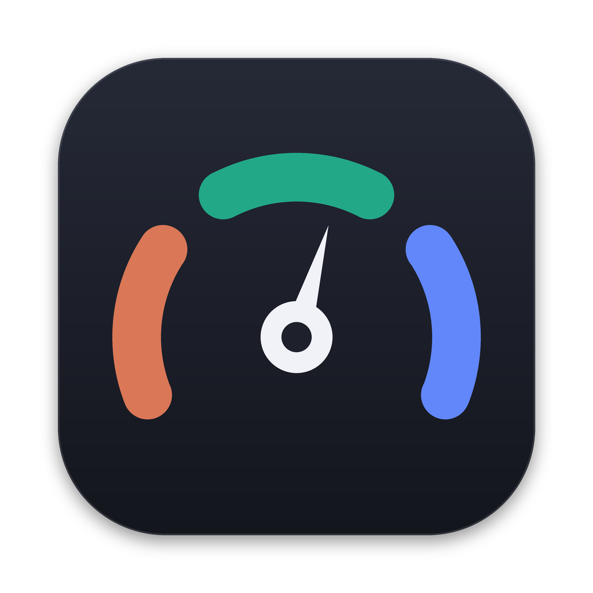
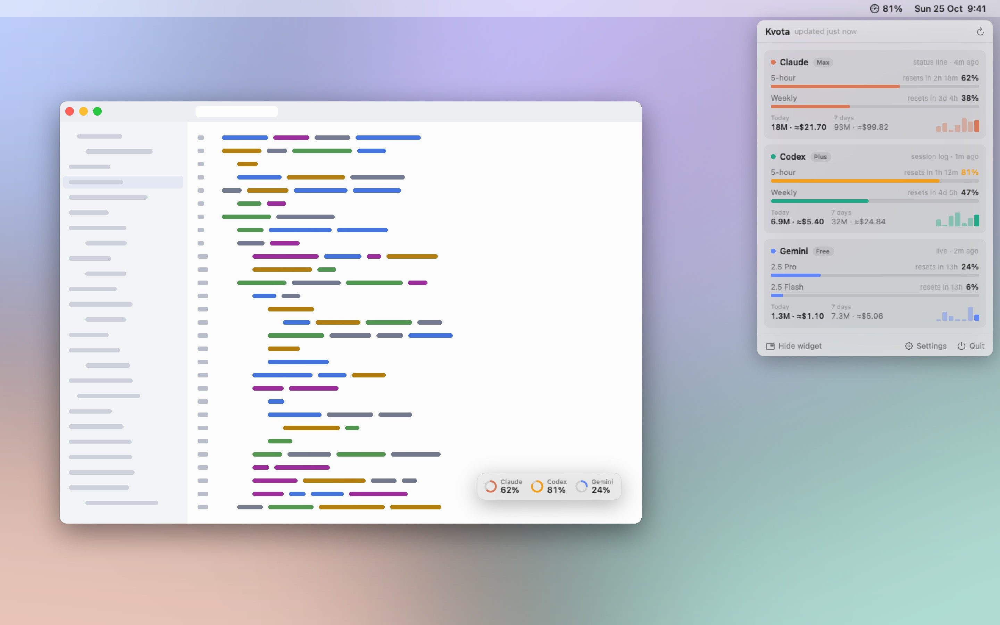
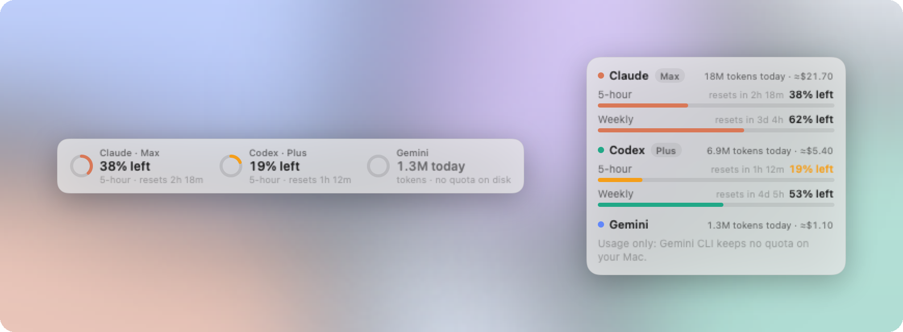
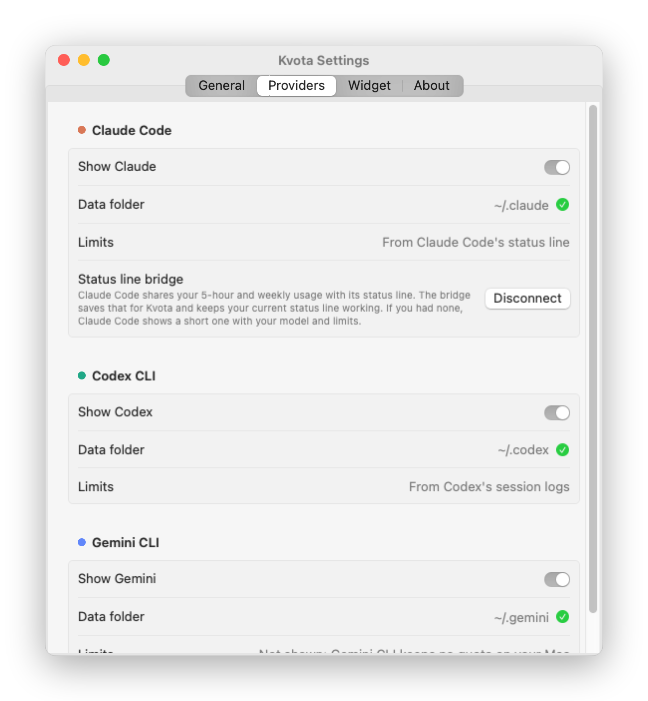

<p align="center">
  
</p>

<h1 align="center">Kvota</h1>

<p align="center">
  Your Claude, Codex and Gemini limits at a glance — in the menu bar and in a tiny widget that floats over your work.
</p>

<p align="center">
  <a href="https://github.com/lrrrrrrrr/kvota/actions/workflows/ci.yml"></a>
  
  
  <a href="LICENSE"></a>
</p>

<picture>
  <source media="(prefers-color-scheme: dark)" srcset="docs/screenshots/hero-dark.jpg">
  
</picture>

## What it shows

- **5-hour and weekly limits** with countdowns to the reset: Codex from its own session
  logs, Claude through Claude Code's status line.
- **Tokens used** today, in the last 5 hours, 7 days and this month, per model, with an
  estimated API-equivalent cost.
- **A floating widget** that stays above your windows on every Space, fades when you're
  not looking at it, can sit behind windows or become click-through, and is draggable
  anywhere. Compact (one ring per tool) or detailed (bars and reset times).
- **The menu bar**: an icon with your highest usage, usage per tool, or just the icon.
- **Alerts** when a limit passes your threshold (and again at 95%).

<picture>
  <source media="(prefers-color-scheme: dark)" srcset="docs/screenshots/widgets-dark.png">
  
</picture>

<p align="center"><sub>Compact and detailed widget. Screenshots use sample data.</sub></p>

## How it gets the numbers

No passwords, no API keys, no network. Kvota reads what the CLIs already store on your Mac:

| | Usage | Limits |
|---|---|---|
| **Codex CLI** | `~/.codex/sessions/**/rollout-*.jsonl` | In the same files — every reply logs the 5-hour and weekly limits |
| **Claude Code** | `~/.claude/projects/**/*.jsonl` | Claude Code passes them to status line commands; Kvota's bridge saves them (your status line keeps working) |
| **Gemini CLI** | `~/.gemini/tmp/*/chats/*.jsonl` | Not stored on your Mac, so not shown |

Claude limits are account-wide (chat, desktop, cloud sessions and Claude Code share
them), and the status line reports exactly those numbers each time you use the `claude`
command. Kvota never guesses a limit and never reads a sign-in: Anthropic doesn't allow
third-party apps to use Claude sign-ins or session tokens. Details and troubleshooting:
[docs/HOW_IT_WORKS.md](docs/HOW_IT_WORKS.md).

## Light on resources

Native Swift (SwiftUI + AppKit), no Electron, no web views. Kvota watches the log
folders with FSEvents instead of polling, reads only the bytes appended since the last
look, and keeps usage as 15-minute per-model totals rather than whole transcripts.

## Install

- **Download** the latest `Kvota-x.y.z.zip` from [Releases](https://github.com/lrrrrrrrr/kvota/releases),
  unzip and move Kvota to Applications.
- **Mac App Store**: coming soon (sandboxed, local files only — see [docs/APP_STORE.md](docs/APP_STORE.md)).
- **From source** (Xcode 16+):

  ```sh
  brew install xcodegen
  git clone https://github.com/lrrrrrrrr/kvota && cd kvota
  make open      # generates Kvota.xcodeproj and opens it; run the "Kvota" scheme
  # or, without Xcode's UI:
  make run       # swift run, straight from the package
  ```

The release build isn't notarized yet: the first time, open Kvota, then allow it in
System Settings → Privacy & Security → "Open Anyway".

On first launch Kvota opens its settings. For Claude limits, click **Connect** next to
"Status line bridge", then send a message with the `claude` command in Terminal.

<p align="center">
  <picture>
    <source media="(prefers-color-scheme: dark)" srcset="docs/screenshots/settings-dark.png">
    
  </picture>
</p>

## Two builds

| | `Kvota` (direct) | `KvotaAppStore` |
|---|---|---|
| Sandbox | No (hardened runtime) | Yes |
| Folder access | Automatic | You pick `~/.claude`, `~/.codex`, `~/.gemini` once |
| Network | None | None |

## Project layout

```
KvotaKit/                 Swift package
  Sources/KvotaCore       Log parsers, incremental scanner, limits, pricing (macOS + Linux)
  Sources/KvotaUI         Menu bar, floating widget, settings, app model
  Tests/                  Parser/engine tests and UI snapshot rendering
App/                      App entry point, Info.plist, entitlements, assets
project.yml               XcodeGen spec for both app targets
scripts/                  Icon and price-table generators
```

`make test` runs the tests; CI runs them on macOS and Linux and builds both apps.
The screenshots are rendered from the real views with sample data on a Mac runner and
composed by `scripts/compose-screenshots.py` (the `Screenshots` workflow keeps them
up to date).

## License

MIT © 2026 Mykola Sleta

Third-party software and data: [docs/THIRD_PARTY_NOTICES.md](docs/THIRD_PARTY_NOTICES.md).
